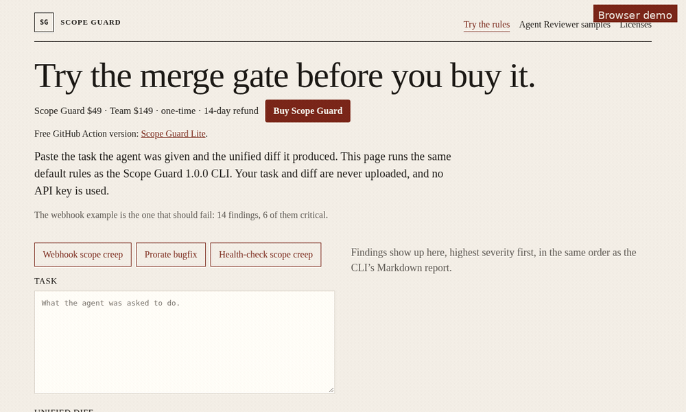

# Scope Guard Lite

**Your coding agent was asked to fix one file. The PR also touches `.env`, a migration and `package.json`. Would you notice before you merge?**

Scope Guard Lite is a free GitHub Action for pull requests written by AI coding agents (Claude Code, Cursor, Copilot, Codex and the like). It leaves **one PR comment** listing:

- **Committed secrets**: AWS, GitHub, Stripe, Slack, Google, npm, PyPI and SendGrid keys, private keys, JWTs, and database URLs with a password. Values are redacted.
- **Destructive SQL**: `DROP TABLE` and `DROP COLUMN` on added lines.
- **Files outside the paths you allow**: you list where the change should go, and anything else is flagged.

It warns only and never blocks a merge. It needs no API key and no checkout step, and it sends your code to no third party.



_Browser demo of the rules running on the [try-it page](https://scope-guard-demo.netlify.app/?example=webhook-scope-creep). The free Action leaves a similar findings table as a PR comment._

**Try the rules in your browser first, no install and no sign-up:** https://scope-guard-demo.netlify.app/

## Set up in one minute

Add `.github/workflows/scope-guard-lite.yml`:

    name: Scope Guard Lite
    on: pull_request
    permissions: { contents: read, pull-requests: write }
    jobs:
      check:
        runs-on: ubuntu-latest
        steps:
          - uses: gillardlogan/scope-guard-lite@v1
            with:
              allowed-paths: |
                src/**
                tests/**

Leave out `with:` and `allowed-paths` if you only want the secret and SQL checks.

## Free vs paid at a glance

| | Lite (free, MIT) | [Scope Guard](https://gillardlogan.gumroad.com/l/scope-guard) ($49 personal, $149 team of up to 10, one-time) |
| --- | --- | --- |
| Secrets, `DROP TABLE` / `DROP COLUMN`, out-of-scope files | Yes | Yes, plus high-entropy secrets and Rails, Django and Prisma drops |
| Blocks the merge | No, warns only | Yes, fails the job at the severity you choose |
| Flags files the task never mentions | No | Yes, without an API key |
| Other rules | None | 20 rules in total, including major dependency bumps, deleted jobs, auth, payment and config paths, CI workflow edits and lockfile churn |
| Runs as | GitHub Action | GitHub Action, CLI, pre-commit hook, plus skill files for Cursor and Claude Code |

Full table below. Refunds within 14 days. Support is by email only: gillardlogan@gmail.com.

**How this differs from [agent-gate](https://github.com/brett-buskirk/agent-gate):** agent-gate is also free and MIT, and unlike Lite it can block merges. It checks secrets, scope, diff size, missing tests and dependency changes, with an optional Claude-based intent check. Lite does less: it focuses on secrets, dropped tables and columns, and out-of-scope files, and only warns. If you want a free blocking gate, agent-gate is a good choice. Scope Guard (paid) is for teams who also want destructive-migration, deleted-job, auth/payment-path and task-vs-diff checks in one config, run the same way in CI, pre-commit and the editor.

## Quick start

Add `.github/workflows/scope-guard-lite.yml`:

```yaml
name: Scope Guard Lite
on: pull_request
permissions: { contents: read, pull-requests: write }
jobs:
  check:
    runs-on: ubuntu-latest
    steps:
      - uses: gillardlogan/scope-guard-lite@v1
```

The step is the last two lines. To flag edits outside certain folders, add:

```yaml
        with:
          allowed-paths: |
            src/billing/**
            tests/billing/**
```

## Inputs

| Input | Default | Meaning |
| --- | --- | --- |
| `allowed-paths` | none | Glob patterns (one per line or comma-separated). Files outside them are flagged. Leave empty to skip this check. |
| `task` | PR title and body | Task description. Shown in the comment. Lite does not compare it with the diff (the full version does). |
| `comment` | `true` | Set to `false` to skip the PR comment. Findings still go to the job summary. |
| `github-token` | `github.token` | Needs `pull-requests: write` to comment. |

Fork PRs get a read-only token from GitHub, so the comment cannot be posted there. Lite writes the findings to the job summary instead.

## Sample comment

Real output from a test PR that added a fake AWS key id, a fake database URL, `DROP TABLE` and `DROP COLUMN` (with `allowed-paths: src/**`). Evidence lines are redacted or collapsed in the full comment:

> ## Scope Guard Lite
>
> **5 findings** in 3 files scanned (4 critical). This is a warning only; it does not block the merge.
>
> | Severity | Rule | Location | Summary |
> | --- | --- | --- | --- |
> | critical | `db.drop_table` | `db/001_cleanup.sql:1` | Dropped table billing_ledger |
> | critical | `db.drop_column` | `db/001_cleanup.sql:2` | Dropped column users.legacy_id |
> | critical | `secret.committed` | `src/config.py:1` | Committed secret (AWS access key id) |
> | critical | `secret.committed` | `src/config.py:2` | Committed secret (database URL with an embedded password) |
> | high | `scope.outside_allowed` | `db/001_cleanup.sql` | Path outside allowed-paths: db/001_cleanup.sql |
>
> _Checked against `allowed-paths`: `src/**`._
>
> _Task read: "Fix greeting text Task: change the greeting in src/app.py only.". Lite does not compare it with the diff._
>
> ---
> Want it to block merges and run the full rule set? [Scope Guard](https://gillardlogan.gumroad.com/l/scope-guard) on Gumroad.

## Full comparison with the paid version

Scope Guard Lite is the free subset of [Scope Guard](https://gillardlogan.gumroad.com/l/scope-guard), a paid merge gate for AI-agent changes.

| | Lite (free) | Scope Guard (paid) |
| --- | --- | --- |
| Committed secrets | Known key formats and database URLs | Also high-entropy secret assignments |
| Destructive SQL | `DROP TABLE`, `DROP COLUMN` | Also Rails, Django and Prisma drops, and any changed migration |
| Files outside an allowed list | Yes (`allowed-paths`) | Yes, plus `blocked_patterns` with your own severity and reason |
| Blocks the merge | No, warns only | Yes: fails the job at the severity threshold you set, so it can be a required check |
| Other rules | None | 20 rules in total: major dependency bumps, added or removed dependencies, deleted files and jobs, auth, payment, secrets and config paths, CI workflow edits, lockfile changes, paths the task never mentions |
| Task vs diff | Task is shown only | Checks which changed paths the task never mentions; optional model pass with your own API key |
| Config | Action inputs | `scope.yml`: threshold, per-rule severity, allowlist entries with reasons, allowed and blocked paths |
| Where it runs | GitHub Action | GitHub Action, command line, pre-commit hook, plus skill files for Cursor and Claude Code |
| Output | PR comment | Text, JSON and Markdown reports and a PR comment |
| Price | Free, MIT | $49 personal, $149 for one team or organization (up to 10 people) |

The paid version is a separate product with its own source and licence. This repository only contains the free checks above.

- Try the checks in your browser, with no install: https://scope-guard-demo.netlify.app/
- Get the full version: https://gillardlogan.gumroad.com/l/scope-guard

## Limits

- It scans added lines in the PR diff. A secret that was already in the repository is not found.
- Very large diffs (over about 20,000 lines) are not returned by the GitHub API. Lite skips the check with a warning.
- Pattern matching finds common formats. It does not find every secret, and it is not a replacement for a secret scanner or a code review.
- Ignored paths: `node_modules/`, `vendor/`, `third_party/`, `dist/`, `build/`, `.next/`, `coverage/`, minified JavaScript and source maps.

## License

MIT. See [LICENSE](LICENSE).

See also the [changelog](CHANGELOG.md).
